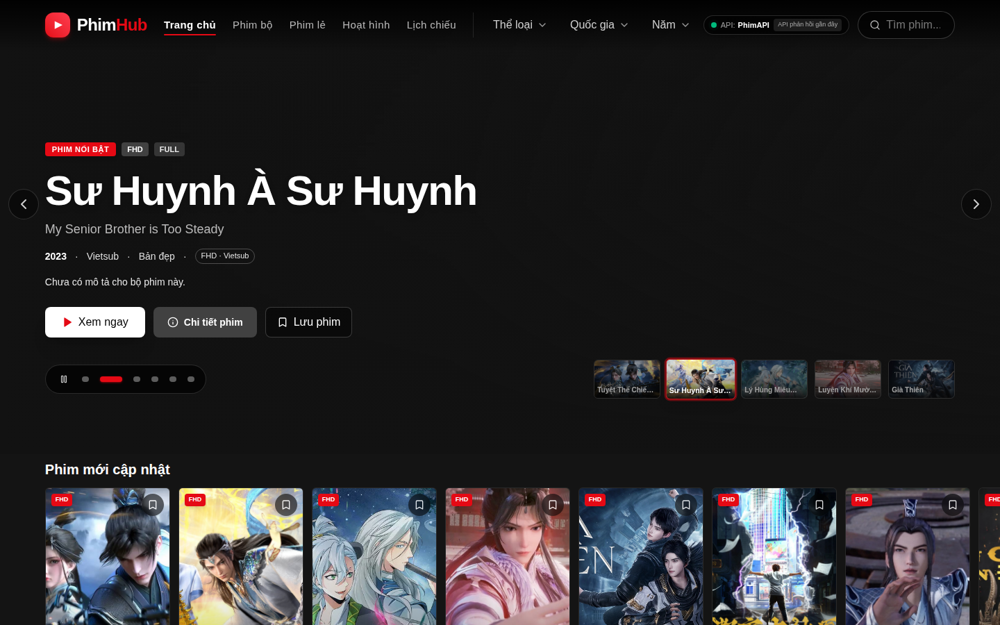

# PhimHub

Website khám phá và xem phim phong cách Netflix, xây dựng bằng React, TypeScript, Vite, Tailwind CSS và React Router.



## Tính năng

- Trang chủ có hero banner, carousel phim vuốt ngang và trailer tự phát tắt tiếng khi Cinemeta có trailer.
- Tìm kiếm có debounce, gợi ý phim và điều hướng bằng bàn phím.
- Lọc danh mục theo thể loại, quốc gia và năm; bộ lọc được lưu trong URL.
- Trang chi tiết có mô tả, đạo diễn, diễn viên, danh sách tập, phim cùng thể loại và hỗ trợ tiếp tục xem.
- Danh sách yêu thích, lịch sử xem và tiến độ xem được lưu trên thiết bị bằng `localStorage`.
- Điểm IMDb được lấy từ Cinemeta; kết quả tìm theo tên chỉ được dùng khi tên và năm phát hành khớp.
- Hỗ trợ PhimAPI và NguonC, tự chuyển nguồn khi API gặp lỗi.
- Skeleton, trạng thái lỗi có thể thử lại, trạng thái rỗng và trang 404 có điều hướng.
- Route được lazy-load; ảnh poster tải lười; giao diện hỗ trợ mobile, vuốt carousel và thao tác player bằng bàn phím.
- TanStack Query cache kết quả API, hủy request khi không còn cần thiết và tự retry khi lỗi.
- PWA có thể cài đặt và lưu app shell cơ bản để mở trang khi offline; dữ liệu phim và video không được cache offline.
- Open Graph và Twitter Card dùng metadata mặc định trong HTML tĩnh để các bot mạng xã hội đọc được.

## Công nghệ

- React 19, TypeScript, Vite 6
- React Router 7, TanStack Query 5
- Tailwind CSS 4, Lucide, HLS.js
- Vitest, Testing Library

## Demo và Open Graph

Website đã triển khai tại: [https://phimhub-kappa.vercel.app](https://phimhub-kappa.vercel.app)
Ảnh demo: [`public/demo-home.png`](./public/demo-home.png).

Để ảnh Open Graph hoạt động với bot mạng xã hội trên website đã deploy, cấu hình URL gốc HTTPS của website trong biến môi trường build:

```env
VITE_SITE_URL=https://phimhub-kappa.vercel.app
```

Khi chưa cấu hình `VITE_SITE_URL`, thẻ OG vẫn được render trong HTML nhưng URL ảnh là đường dẫn tương đối. Thay thế tên miền mẫu bằng domain thực trước khi deploy.

## Chạy dự án

```bash
npm install
npm run dev
```

Mở URL được in trong terminal (thường là `http://localhost:5173`).

## Build và preview production

```bash
npm run build
npm run preview
```

Để kiểm tra PWA/service worker, cần chạy bản production qua HTTPS hoặc `localhost`.

## Lighthouse

Chạy Lighthouse trên bản production local:

```bash
npm run build
npm run preview
npx lighthouse http://localhost:4173/ --view
```

Lần đo local gần nhất (Lighthouse mobile simulation): Performance 78, Accessibility 100, Best Practices 96, SEO 100; LCP 4.9 giây, TBT 230 ms, CLS 0. Điểm Performance chưa đạt mục tiêu 90. LCP phụ thuộc API phim và ảnh hero từ máy chủ bên ngoài, nên có thể thay đổi theo mạng, thiết bị và dữ liệu nguồn; cần chạy lại sau khi deploy trên domain thực.

## Kiểm thử

```bash
npm test
```

## Backend cá nhân hóa và quản trị

Các model và Express router ở `models/`, `middleware/` và `routes/` cung cấp lịch sử xem, lịch sử tìm kiếm và API quản trị. Cần cấu hình `MONGODB_URI`, `JWT_SECRET` và `IP_HASH_SECRET` trong môi trường Node.js. `IP_HASH_SECRET` phải là chuỗi ngẫu nhiên tối thiểu 32 ký tự, chỉ được giữ ở backend và dùng để tạo HMAC-SHA-256 từ địa chỉ IP; địa chỉ IP gốc không được ghi vào MongoDB. Mã HMAC là định danh giả danh ổn định, không phải dữ liệu ẩn danh hoàn toàn. JWT phải được ký bằng HS256 và chứa claim `sub` bằng MongoDB ObjectId của tài khoản; quyền Admin được đọc từ tài khoản hiện tại trong MongoDB chứ không được tin cậy từ claim của token.

Trang Admin Dashboard nằm tại `/admin`. Trang có danh sách tài khoản đã đăng ký và tab khách truy cập được nhận diện bằng mã HMAC; mã này không tiết lộ IP gốc và không suy ra tên thật. Trang hỗ trợ xem lịch sử xem/tìm kiếm cho từng tài khoản hoặc khách. Các API admin yêu cầu token của tài khoản có role `admin`. Telemetry từ frontend không yêu cầu khách đăng nhập; nếu Express đứng sau proxy, chỉ cấu hình `trust proxy` cho các proxy tin cậy để `request.ip` không bị giả mạo.

Mount các router trong Express sau khi kết nối MongoDB và bật middleware JSON:

```js
import express from "express";

import adminRouter from "./routes/admin.js";
import telemetryRouter from "./routes/telemetry.js";

const app = express();
app.use(express.json({ limit: "16kb" }));
app.use("/api/telemetry", telemetryRouter);
app.use("/api/admin", adminRouter);
```

Tạo tài khoản quản trị bằng một quy trình provisioning được bảo vệ và đặt `role` thành `admin`; không cho phép client tự chọn quyền trong quá trình đăng ký. Tài khoản nên được tạo qua `User.create(...)` để mật khẩu được băm bằng scrypt trước khi lưu. `GET /api/admin/users/:userId/details` yêu cầu Bearer token của tài khoản quản trị và không trả về trường mật khẩu.

Frontend gửi telemetry khách mà không cần đăng nhập. Backend dùng HMAC IP ổn định để nhóm các lượt xem/tìm kiếm từ cùng một địa chỉ mạng; nhiều người dùng chung mạng có thể bị gộp, còn IP động/VPN có thể tạo mã khác. Cách này không xác định tên người dùng thật. Đặt `VITE_BACKEND_API_BASE` thành origin backend (ví dụ `http://localhost:3000`); để trống nếu frontend và backend dùng chung origin. Tiến trình xem được gửi tối đa mỗi 15 giây trong lúc phát video.

Nếu database đã tạo unique index cũ cho lịch sử xem theo `userId` và `movieId`, phải thay index đó bằng index partial mới một lần trước khi triển khai telemetry khách:

```javascript
db.watchhistories.dropIndex("userId_1_movieId_1")
```
